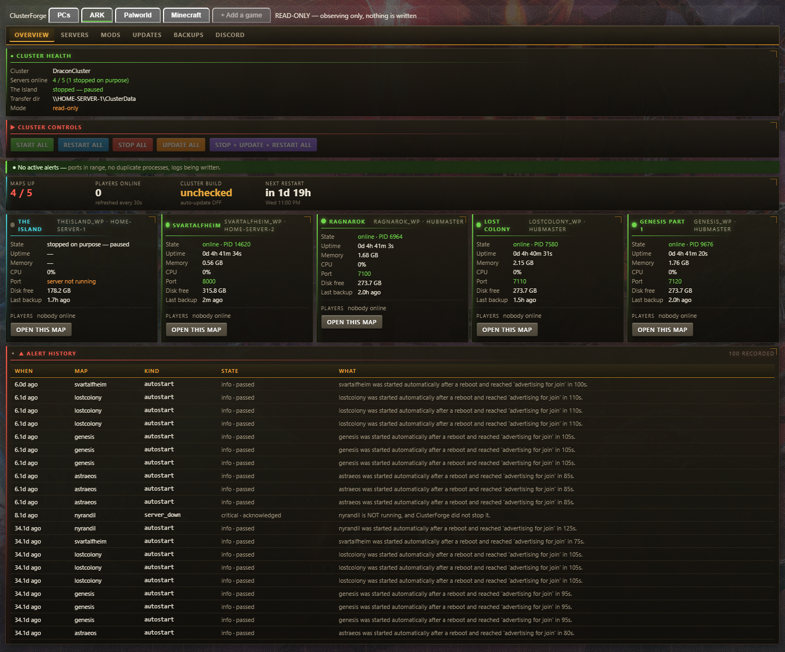
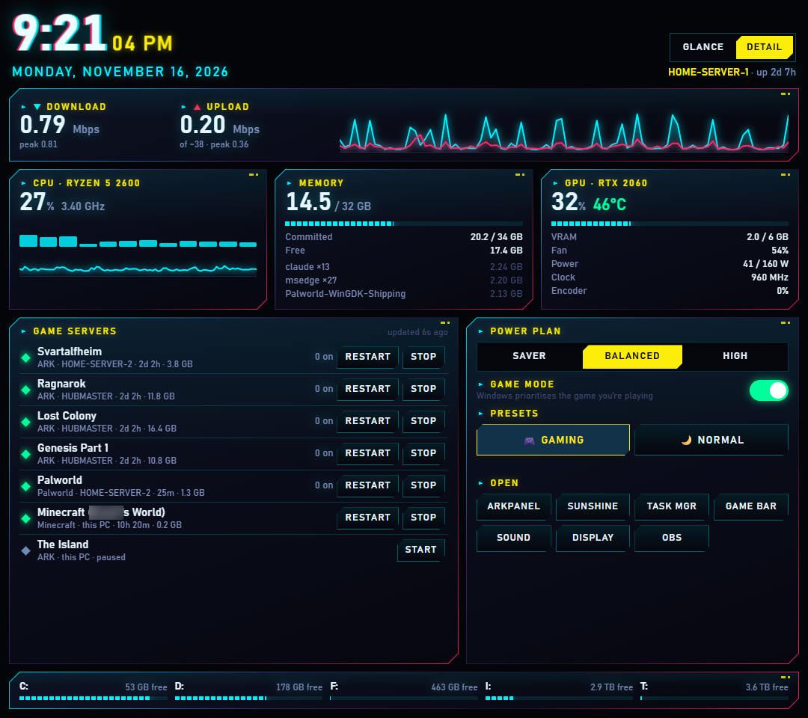

# Home game-server cluster tools

Two self-hosted Windows projects for running game servers at home and playing and streaming on the same PC.

| | |
|---|---|
| **[ClusterForge](ClusterForge/)** | A web control panel for a multi-PC game-server cluster: ARK: Survival Ascended (multi-map cluster), Palworld, Minecraft Bedrock and 7 Days to Die. It includes cluster-coordinated auto-updates, backups, Discord bots and an installable phone app. |
| **[PCDash](PCDash/)** | A live stats dashboard for a spare portrait monitor, with server buttons, OBS stream control, a per-game webcam background, a game-art screensaver, and firmware for a 5" touchscreen, a round stream screen and a USB key pad. |

Both run on Windows 10 or 11 with Python 3.12. See each folder's README for setup.

---

## License

[PolyForm Noncommercial 1.0.0](LICENSE.md). You're free to use, study and change it for personal, hobby, educational and other **noncommercial** purposes. **Commercial use, including selling it or running it as a paid service, isn't allowed** without a separate licence from the author; open an issue to ask.
